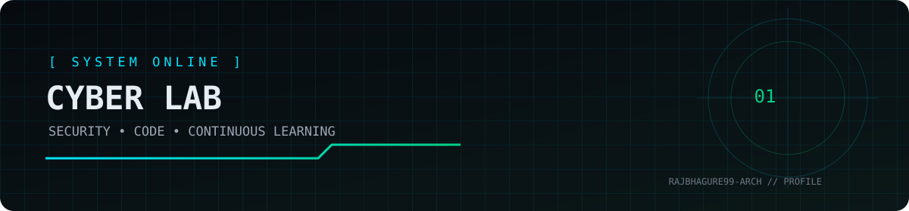
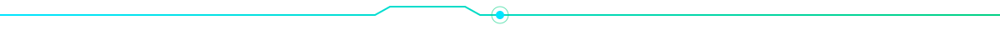

<!--
  RAJBHAGURE99-ARCH :: CYBER LAB PROFILE
  Theme: matte black / electric cyan / emerald
  GitHub README does not support custom CSS backgrounds.
-->

<div align="center">



# `RAJBHAGURE99-ARCH`

### `> Security mindset. Builder energy. Continuous learning.`

<p>
  <a href="https://github.com/rajbhagure99-arch"></a>
  
  
</p>

<p>
  <a href="#-about-the-lab">ABOUT</a> ·
  <a href="#-tech-stack">STACK</a> ·
  <a href="#-featured-projects">PROJECTS</a> ·
  <a href="#-activity-console">ACTIVITY</a> ·
  <a href="#-connect">CONNECT</a>
</p>

</div>

---

## `01 // ABOUT THE LAB`

```text
┌─[ RAJBHAGURE99-ARCH@cyber-lab ]
└──$ whoami
    Learner • Developer • Cybersecurity enthusiast

└──$ mission
    Build useful projects, understand how systems work,
    and learn security through ethical, authorized practice.

└──$ current_mode
    STUDYING / BUILDING / DOCUMENTING
```

- 🔐 Interested in **cybersecurity, ethical security testing, and web development**.
- 🧰 Learning by building practical projects and documenting what I discover.
- 🌱 Focused on strong fundamentals, clean code, and responsible security.
- 🎯 Goal: turn consistent learning into useful, well-documented work.

> **Principle:** Test only systems you own or have explicit permission to assess.

---

## `02 // TECH STACK`

<!-- Keep only technologies you actively use; replace placeholders honestly. -->

<p align="center">
  
  
  
  
  
  
</p>

**Edit this list:** badges are starter labels, not certifications or claims of expertise. Change each label to `using`, `learning`, or remove it to match your actual experience.

---

## `03 // FEATURED PROJECTS`

<!-- Replace each placeholder with a real repository and an accurate description. -->

<table>
  <tr>
    <td width="50%" valign="top">
      <h3>⌁ Project One — <code>[PROJECT_NAME]</code></h3>
      <p><b>Status:</b> <code>PLACEHOLDER — REPLACE ME</code></p>
      <p>[Describe what the project does, the problem it solves, and what you learned.]</p>
      <p><b>Built with:</b> [TECH_STACK]</p>
      <a href="https://github.com/rajbhagure99-arch">View repositories →</a>
    </td>
    <td width="50%" valign="top">
      <h3>⌁ Project Two — <code>[PROJECT_NAME]</code></h3>
      <p><b>Status:</b> <code>PLACEHOLDER — REPLACE ME</code></p>
      <p>[Add a short, truthful summary of a second real project.]</p>
      <p><b>Built with:</b> [TECH_STACK]</p>
      <a href="https://github.com/rajbhagure99-arch">View repositories →</a>
    </td>
  </tr>
  <tr>
    <td width="50%" valign="top">
      <h3>⌁ Project Three — <code>[PROJECT_NAME]</code></h3>
      <p><b>Status:</b> <code>PLACEHOLDER — REPLACE ME</code></p>
      <p>[Mention a lab, tool, website, or learning project you have actually completed.]</p>
      <p><b>Built with:</b> [TECH_STACK]</p>
      <a href="https://github.com/rajbhagure99-arch">View repositories →</a>
    </td>
    <td width="50%" valign="top">
      <h3>⌁ Current Lab Notes</h3>
      <p>Use this space for write-ups, notes, or learning logs you are comfortable sharing publicly.</p>
      <p><b>Status:</b> <code>UPDATE WITH REAL LINK</code></p>
      <a href="https://github.com/rajbhagure99-arch?tab=repositories">Browse repositories →</a>
    </td>
  </tr>
</table>

---

## `04 // ACTIVITY CONSOLE`

<div align="center">

<a href="https://github.com/rajbhagure99-arch">
  
</a>
<a href="https://github.com/rajbhagure99-arch">
  
</a>


</div>

<sub>Stats are provided by third-party services and may be delayed, unavailable, or subject to their own limits. They are not certifications or measures of security skill.</sub>

---

## `05 // CONTRIBUTION SIGNAL`

<div align="center">

<!-- Generated by .github/workflows/snake.yml. The workflow creates output files on the `output` branch. -->
<picture>
  <source media="(prefers-color-scheme: dark)" srcset="https://raw.githubusercontent.com/rajbhagure99-arch/rajbhagure99-arch/output/github-contribution-grid-snake-dark.svg" />
  <source media="(prefers-color-scheme: light)" srcset="https://raw.githubusercontent.com/rajbhagure99-arch/rajbhagure99-arch/output/github-contribution-grid-snake.svg" />
  
</picture>

</div>

<sub>If the animation is missing, check the Actions tab, workflow permissions, and whether the `output` branch exists.</sub>

---

## `06 // NEXT OBJECTIVES`

- [ ] Replace all project placeholders with real projects.
- [ ] Add concise READMEs to important repositories.
- [ ] Publish learning notes that contain no secrets or sensitive data.
- [ ] Keep skills and tools listed here accurate and current.
- [ ] Build consistently; prioritize understanding over badge collecting.

---

## `07 // CONNECT`

<div align="center">

<a href="https://github.com/rajbhagure99-arch"></a>
<!-- OPTIONAL: Replace the placeholder below with a real public LinkedIn or portfolio URL. -->
<!-- <a href="YOUR_REAL_PORTFOLIO_URL"></a> -->

<br/>



<sub><code>ACCESS: PUBLIC</code> · <code>MODE: LEARNING</code> · <code>KEEP BUILDING.</code></sub>

</div>
